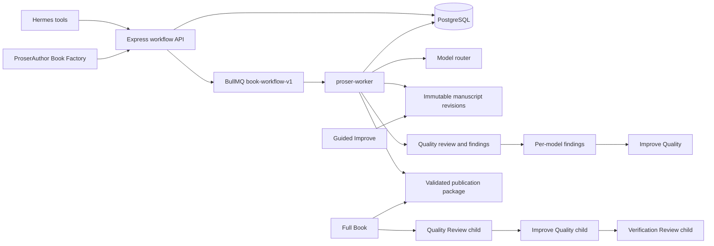

# ProserFactory workflow v1

All four workflow types share the queue, tasks, events, heartbeat, retries, checkpoints, revision ancestry, and audit trail. Full Book is the only parent workflow and invokes its editorial workflows as visible children.
